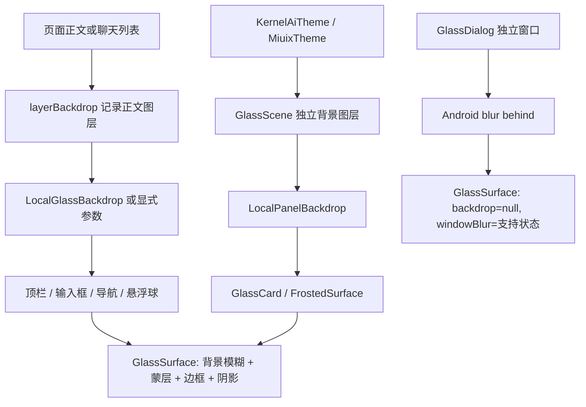

# 轻微 MCP：毛玻璃与弹窗模糊实现方案

整理日期：2026-11-20。依据：Qingwei 0.4.0 / 400，界面实现提交 `67b8c40`，整理前仓库 HEAD 为 `832f6c3`。

本文说明项目已经采用的方案，供其他 Kotlin / Compose 项目复用。核心代码块摘自当前源码；示例和后续建议另作标注。它是一套背景模糊、半透明蒙层、边框和阴影组成的玻璃风格，没有额外实现物理折射或液态透镜变形。

## 1. 总体方案：页面内模糊与弹窗模糊分开实现

| 场景 | 实现 | 模糊对象 | 前景内容 |
| --- | --- | --- | --- |
| 顶栏、输入框、悬浮导航、回到最新小球 | Miuix `LayerBackdrop` + `textureBlur` | 当前页面中被记录的背景内容 | 文字、图标、输入内容保持清晰 |
| 设置、模型、工作区、进程等内容卡片 | `GlassScene` 提供独立背景，再由 `GlassCard` / `FrostedSurface` 采样 | 独立的纯色与渐变背景 | 卡片正文保持清晰 |
| 用量、选择器、确认框等独立弹窗 | Compose `Dialog` + Android `FLAG_BLUR_BEHIND` | 弹窗窗口后面的整幅画面 | 弹窗面板及其文字保持清晰 |

关键是先确定“采样哪一层”，再设置玻璃面板样式。给整个父容器直接添加 `Modifier.blur()` 会模糊父容器自身及其子内容，不能替代这里的背景采样方案。



页面内容与覆盖组件应为兄弟层级；不要把覆盖组件也放入同一个被捕获的背景中，否则容易形成重复采样或视觉反馈。

## 2. 源码位置与职责

下列链接固定到界面实现提交，便于对照，不依赖阅读者电脑上的目录。

| 文件 | 职责 |
| --- | --- |
| [GlassSurface.kt](https://github.com/AIFORTMIX/building_test/blob/67b8c40/app/src/main/java/com/kernelai/app/ui/screen/chat/GlassSurface.kt) | 样式参数、能力判断、统一玻璃容器 |
| [GlassScene.kt](https://github.com/AIFORTMIX/building_test/blob/67b8c40/app/src/main/java/com/kernelai/app/ui/components/GlassScene.kt) | 独立背景图层、`LocalPanelBackdrop`、卡片与表面封装 |
| [GlassDialog.kt](https://github.com/AIFORTMIX/building_test/blob/67b8c40/app/src/main/java/com/kernelai/app/ui/screen/chat/GlassDialog.kt) | 独立弹窗窗口、系统背后模糊、遮罩与弹窗布局 |
| [GlassNavigation.kt](https://github.com/AIFORTMIX/building_test/blob/67b8c40/app/src/main/java/com/kernelai/app/ui/components/GlassNavigation.kt) | 横向底部导航与横屏侧边导航 |
| [MiuixControls.kt](https://github.com/AIFORTMIX/building_test/blob/67b8c40/app/src/main/java/com/kernelai/app/ui/components/MiuixControls.kt) | 通用菜单、确认框等接入玻璃弹窗 |
| [MainActivity.kt](https://github.com/AIFORTMIX/building_test/blob/67b8c40/app/src/main/java/com/kernelai/app/ui/MainActivity.kt) | 每个主页面独立维护背景，向当前导航传递对应图层 |
| [ChatScreen.kt](https://github.com/AIFORTMIX/building_test/blob/67b8c40/app/src/main/java/com/kernelai/app/ui/screen/chat/ChatScreen.kt) | 聊天背景记录、全宽顶栏、悬浮输入区与回到最新小球 |
| [KernelAiTheme.kt](https://github.com/AIFORTMIX/building_test/blob/67b8c40/app/src/main/java/com/kernelai/app/ui/theme/KernelAiTheme.kt) | Miuix 主题、前景颜色、全局 `GlassScene` 入口 |
| [UsagePanel.kt](https://github.com/AIFORTMIX/building_test/blob/67b8c40/app/src/main/java/com/kernelai/app/ui/screen/chat/UsagePanel.kt) | `GlassDialog` 内展示用量卡片的实际用例 |

## 3. 依赖与版本约束

界面使用 Compose 布局和 Miuix 主题、文字、按钮等组件，不使用 Material 主题搭建玻璃样式。

当前版本的相关配置：

| 项目 | 当前值 |
| --- | --- |
| Miuix UI / blur | `0.9.2` |
| Kotlin / Compose 编译插件 | `2.4.0` |
| Android Gradle Plugin | `9.2.1` |
| 项目 compileSdk / minSdk | `37` / `28` |
| 0.4.0 验收 APK 的 AndroidX Compose runtime / UI | `1.11.2` |
| Android Compose 测试库 | `ui-test-junit4:1.11.2` |

依赖调用在项目中采用版本目录别名，等价的直接依赖写法为：

```kotlin
implementation("top.yukonga.miuix.kmp:miuix-ui-android:0.9.2")
implementation("top.yukonga.miuix.kmp:miuix-blur-android:0.9.2")
```

这里列的是已经使用的组合，不代表最新版本。项目声明的 Compose BOM 是 `2024.12.01`，实际依赖解析还受到 Miuix 等传递依赖影响，因此不能仅根据 BOM 名称判断最终 runtime 版本。迁移时应核对解析结果和 APK，而不是同时照搬一个旧 BOM 与任意版本的测试库。

项目的 `miuix-blur-android:0.9.2` AAR 声明 `minSdkVersion=33`；主项目保留 minSdk 28，并在 Manifest 中使用了以下覆盖：

```xml
<!-- 根 manifest 需要声明 xmlns:tools="http://schemas.android.com/tools" -->
<uses-sdk tools:overrideLibrary="top.yukonga.miuix.kmp.blur" />
```

此配置只覆盖 Manifest 合并检查，不会为旧系统补齐 API。项目同时进行了运行时模糊能力判断。新项目优先遵循库的最低版本要求；若要保留更低 minSdk，必须保留降级分支并单独验证低版本设备。本项目已有的 API 35、37.1 验收不能替代 API 28–32 的验证。

## 4. 统一玻璃容器 GlassSurface

### 4.1 当前实现

以下代码直接摘录当前实现，省略文件头的 package 和 import。所需类型来自 Compose、Android SDK 和 `top.yukonga.miuix.kmp.blur`，完整导入见源码链接。

```kotlin
internal val LocalGlassBackdrop = staticCompositionLocalOf<LayerBackdrop?> { null }

internal object GlassStyle {
    val Panel = 24.dp
    val Capsule = 32.dp
    const val BlurRadius = 22f
    const val TintAlpha = .68f
}

@Composable
internal fun chatBackground(): Color = MiuixTheme.colorScheme.background

@Composable
internal fun chatForeground(): Color = MiuixTheme.colorScheme.onBackground

@Composable
internal fun glassSupported(): Boolean {
    val view = LocalView.current
    val lowRam = view.context.getSystemService(android.app.ActivityManager::class.java)?.isLowRamDevice == true
    return Build.VERSION.SDK_INT >= 33 && view.isHardwareAccelerated && !lowRam
}

/** Capture and blur only the sibling backdrop. The input, icons and labels stay sharp. */
@Composable
internal fun GlassSurface(
    backdrop: LayerBackdrop? = LocalGlassBackdrop.current,
    modifier: Modifier = Modifier,
    shape: Shape = RoundedCornerShape(GlassStyle.Capsule),
    windowBlur: Boolean = false,
    content: @Composable BoxScope.() -> Unit
) {
    val dark = chatBackground().luminance() < .4f
    var bounded by remember { mutableStateOf(false) }
    val supported = glassSupported() && backdrop != null && bounded
    val tint = if (dark) Color(0xFF24262D) else Color(0xFFF4F5F8)
    val blur = if (supported) Modifier.textureBlur(backdrop = backdrop, shape = shape, blurRadius = GlassStyle.BlurRadius) else Modifier
    Box(modifier.onSizeChanged { bounded = it.width in 1..4096 && it.height in 1..4096 }.shadow(10.dp, shape, ambientColor = Color.Black.copy(alpha = .08f), spotColor = Color.Black.copy(alpha = .10f))
        .then(blur).clip(shape)
        .background(tint.copy(alpha = if (supported || windowBlur) GlassStyle.TintAlpha else .96f))
        .border(1.dp, Brush.verticalGradient(listOf(Color.White.copy(alpha = if (dark) .26f else .95f),
            Color.White.copy(alpha = if (dark) .06f else .35f))), shape), content = content)
}
```

绘制关系可理解为：阴影 → 采样背景并模糊 → 按相同形状裁剪 → 半透明底色 → 渐变边框 → 清晰前景。阴影在裁剪前设置，以免被面板圆角切掉。

`windowBlur` 是本项目自己的样式参数：它只影响底色透明度，不会替调用者开启系统模糊。必须由弹窗窗口配置真正的 `FLAG_BLUR_BEHIND`。

### 4.2 参数与单位

| 参数 | 当前值 | 说明 |
| --- | --- | --- |
| 页面背景模糊半径 | `22f` | Miuix 0.9.2 的 `textureBlur` 将此 Float 按 **dp** 处理，库内部转为像素 |
| 常用面板圆角 | `24.dp` | 顶栏另用 `RectangleShape`，不会被强制变成胶囊 |
| 默认胶囊圆角 | `32.dp` | `GlassSurface` 的默认形状 |
| 内容卡片圆角 | `20.dp` | `GlassCard` 的默认形状 |
| 导航外框圆角 | `28.dp` | `GlassNavigation` 的选择 |
| 正常蒙层 alpha | `0.68` | 真正模糊可用时，保留一定背景可见性 |
| 降级蒙层 alpha | `0.96` | 不再依赖底下的内容提供可读背景 |
| 深色 / 浅色底色 | `#24262D` / `#F4F5F8` | 通过 Miuix 背景亮度 `< 0.4` 判断当前配色 |
| 阴影高度 | `10.dp` | ambient alpha `0.08`、spot alpha `0.10` |
| 边框宽度 | `1.dp` | 白色纵向渐变边框 |
| 深色边框 alpha | 上 `0.26`、下 `0.06` | 与浅色模式分别配置 |
| 浅色边框 alpha | 上 `0.95`、下 `0.35` | 形成边缘高光 |

Miuix 半径单位已核对随项目下载的 `miuix-blur-android-0.9.2-sources.jar` 中 `TextureEffect.kt` 的 API 说明。项目只显式传入 backdrop、shape 和 blurRadius；噪声抖动等其他参数沿用该版本库的默认值，并未额外实现自定义噪声纹理。

不要混淆这里的 `22f` 与系统弹窗的 `blurBehindRadius=36`：后者是 **像素**，不是 36dp。

### 4.3 降级条件

页面内真正执行 `textureBlur` 需要同时满足：

1. Android API ≥ 33。
2. 当前 View 开启硬件加速。
3. `ActivityManager.isLowRamDevice` 为 false。
4. 有可用的 `LayerBackdrop`。
5. 组件测量后宽、高均在 `1..4096` **物理像素**范围内。

`bounded` 初始为 false，因此尚未获得尺寸时先使用近不透明底色。4096 是项目设置的保护阈值，不是查询得到的 GPU 最大纹理尺寸；它降低过大模糊区域的风险，不等于保证任何设备都不会出现显存或内存问题。

降级会跳过该容器的模糊 Modifier，但仍保留圆角、边框、阴影和清晰前景；不表示整个应用不再创建任何 GraphicsLayer。

## 5. 两种背景源：页面正文与独立装饰背景

### 5.1 覆盖在正文上的组件

聊天页将 `LazyColumn` 记录为背景，顶栏、输入框、提示面板与悬浮球放在列表外面，作为兄弟组件读取这个背景。

下面是接入关系示例，放在 Miuix 主题内部的 `@Composable` 函数中；省略业务状态和具体输入框实现：

```kotlin
val background = MiuixTheme.colorScheme.background
val backdrop = rememberLayerBackdrop {
    drawRect(background)
    drawContent()
}

CompositionLocalProvider(LocalGlassBackdrop provides backdrop) {
    Box(Modifier.fillMaxSize()) {
        LazyColumn(
            modifier = Modifier.fillMaxSize().then(
                if (glassSupported()) Modifier.layerBackdrop(backdrop)
                else Modifier
            ),
            // 示例值；正式聊天页使用实际测量的顶栏和输入区高度。
            contentPadding = PaddingValues(top = 84.dp, bottom = 170.dp)
        ) {
            // 聊天正文
        }

        GlassSurface(
            backdrop = backdrop,
            modifier = Modifier.align(Alignment.TopCenter).fillMaxWidth(),
            shape = RectangleShape
        ) {
            Text("整条模糊顶栏", Modifier.padding(20.dp))
        }

        GlassSurface(
            backdrop = backdrop,
            modifier = Modifier.align(Alignment.BottomCenter)
                .fillMaxWidth().padding(16.dp),
            shape = RoundedCornerShape(24.dp)
        ) {
            // 输入框、模型选择、用量入口等清晰前景
        }
    }
}
```

`rememberLayerBackdrop` 创建记录目标，`layerBackdrop` 标记被记录的内容，`textureBlur` 从该目标采样。只创建 backdrop 而不给正文挂 `layerBackdrop`，不能得到实时的正文背景。

正式聊天页还做了这些布局处理：

- 顶栏的 `GlassSurface` 覆盖完整宽度，形状为矩形；状态栏高度放在玻璃容器内部。
- 测量顶栏和输入区域的真实高度，作为聊天列表顶部、底部 contentPadding，防止最后一条回复被遮住。
- 输入区使用 `imePadding()`；键盘显示时调整底部预留空间，避免重复叠加系统导航栏高度。
- “回到最新”使用 `CircleShape` 的玻璃容器，内部是 44dp 的箭头按钮。

### 5.2 普通内容卡片

如果内容卡片去采样包含自己或其他玻璃卡片的页面，就可能不断叠加已经模糊的结果。项目因此提供了第二个背景入口 `LocalPanelBackdrop`，只记录独立的装饰背景。

当前 `GlassScene.kt` 的核心代码如下，省略 package 和 import：

```kotlin
internal val LocalPanelBackdrop = staticCompositionLocalOf<LayerBackdrop?> { null }

@Composable
internal fun GlassScene(content: @Composable () -> Unit) {
    val background = MiuixTheme.colorScheme.background
    val primary = MiuixTheme.colorScheme.primary
    val dark = background.luminance() < .4f
    val backdrop = rememberLayerBackdrop()
    Box(Modifier.fillMaxSize()) {
        Canvas(Modifier.matchParentSize().layerBackdrop(backdrop)) {
            drawRect(background)
            drawRect(Brush.radialGradient(listOf(primary.copy(alpha = if (dark) .15f else .09f), Color.Transparent), Offset(size.width * .15f, size.height * .16f), size.maxDimension * .65f))
            drawRect(Brush.radialGradient(listOf(Color(0xFF817AC9).copy(alpha = if (dark) .09f else .05f), Color.Transparent), Offset(size.width, size.height * .88f), size.maxDimension * .55f))
        }
        CompositionLocalProvider(LocalPanelBackdrop provides backdrop) { content() }
    }
}

@Composable
fun GlassCard(modifier: Modifier = Modifier, content: @Composable ColumnScope.() -> Unit) {
    GlassSurface(LocalPanelBackdrop.current, modifier, RoundedCornerShape(20.dp)) { Column(Modifier.fillMaxWidth(), content = content) }
}

@Composable
fun FrostedSurface(modifier: Modifier = Modifier, shape: Shape = RoundedCornerShape(18.dp), color: Color = Color.Transparent,
    content: @Composable BoxScope.() -> Unit) {
    GlassSurface(LocalPanelBackdrop.current, modifier, shape) {
        Box(Modifier.background(color.copy(alpha = minOf(color.alpha, .10f)), shape), content = content)
    }
}
```

背景先画 Miuix 基础色，再叠加两层低透明度径向渐变。卡片透过模糊与蒙层能获得柔和色差，而卡片里的正文不进入这张背景图层。

它在 `KernelAiTheme` 的 `MiuixTheme` 和颜色 CompositionLocal 内调用：

```kotlin
// 结构示意：省略现有 ThemeController 和状态栏颜色设置。
MiuixTheme(controller = controller) {
    GlassScene {
        AppContent()
    }
}
```

`GlassCard` 和 `FrostedSurface` 的职责不同：前者提供 ColumnScope 卡片内容，后者提供 BoxScope 表面；`FrostedSurface` 还把调用者传入的颜色透明度限制到不超过 0.10，避免原本不透明的 Surface 颜色直接盖住底下的玻璃效果。

现有页面通过导入别名接入，例如：

```kotlin
import com.kernelai.app.ui.components.GlassCard as Card
import com.kernelai.app.ui.components.FrostedSurface as Surface
```

这让页面可以继续使用原来的布局形式与 Miuix 子组件，而不必逐处复制模糊、圆角、底色和边框逻辑。适用页面包括设置、模型、工作区、进程、断点、日志、内存面板与产物卡片；并非将每段聊天正文都变成一张大面积模糊卡片。

### 5.3 多页面与导航

`MainActivity` 为每个固定主页面创建独立 backdrop。导航读取 `backdrops[selectedPage]`，不是共享一张可能被后台保留页面重新记录的正文背景。

竖屏时导航在底部，横屏时位于左侧；键盘出现时隐藏导航。非聊天页面在正文记录层内渲染，聊天页则把对应 backdrop 交给聊天列表记录。迁移到动态页面列表时，还应按稳定页面 ID 管理图层身份，避免页面增删后复用错位。

## 6. 独立弹窗：使用 Android 窗口背后模糊

### 6.1 为什么弹窗需要另一条链路

Compose `Dialog` 拥有独立 Window。直接把 Activity 正文的 backdrop 当作弹窗面板背景，会涉及不同窗口的坐标与图层关系，不能简单照搬页面内覆盖层的结构。

项目的弹窗外层面板因此显式传入 `backdrop=null`，由 Android 窗口系统模糊背后的画面。Android 区分区域性的 window background blur 和整个窗口后方的 blur behind；本项目采用后者，没有调用 `Window.setBackgroundBlurRadius()`。[Android 窗口模糊说明](https://source.android.com/docs/core/display/window-blurs)

### 6.2 当前 GlassDialog 实现

以下同样摘自当前源码，省略 package 和 import：

```kotlin
@Composable
internal fun GlassDialog(show: Boolean, onDismissRequest: () -> Unit, title: String? = null,
    summary: String? = null, content: @Composable () -> Unit) {
    if (!show) return
    Dialog(onDismissRequest, properties = DialogProperties(usePlatformDefaultWidth = false, decorFitsSystemWindows = false)) {
        val view = LocalView.current
        val window = (view.parent as? DialogWindowProvider)?.window
        val blurSupported = Build.VERSION.SDK_INT >= 31 &&
            (view.context.getSystemService(WindowManager::class.java)?.isCrossWindowBlurEnabled == true)
        DisposableEffect(window, blurSupported) {
            window?.apply {
                addFlags(WindowManager.LayoutParams.FLAG_DIM_BEHIND)
                setDimAmount(.18f)
                if (Build.VERSION.SDK_INT >= 31 && blurSupported) {
                    addFlags(WindowManager.LayoutParams.FLAG_BLUR_BEHIND)
                    attributes = attributes.apply { blurBehindRadius = 36 }
                }
            }
            onDispose { }
        }
        BoxWithConstraints(Modifier.fillMaxSize().safeDrawingPadding().imePadding()
            .clickable(remember { MutableInteractionSource() }, indication = null, onClick = onDismissRequest),
            contentAlignment = Alignment.BottomCenter) {
            GlassSurface(null, Modifier.padding(12.dp).widthIn(max = 560.dp).fillMaxWidth()
                .heightIn(max = (maxHeight - 24.dp).coerceAtLeast(80.dp))
                .testTag("glass-dialog")
                .clickable(remember { MutableInteractionSource() }, indication = null) {},
                RoundedCornerShape(GlassStyle.Panel), windowBlur = blurSupported) {
                Column(Modifier.verticalScroll(rememberScrollState()).padding(22.dp), verticalArrangement = Arrangement.spacedBy(14.dp)) {
                    title?.let { Text(it, fontSize = 20.sp, fontWeight = FontWeight.SemiBold) }
                    summary?.let { Text(it, fontSize = 13.sp, color = chatForeground().copy(alpha = .7f)) }
                    content()
                }
            }
        }
    }
}
```

窗口相关参数如下：

| 参数 | 当前值 | 作用 |
| --- | --- | --- |
| 系统 API 门槛 | API ≥ 31 | 再检查 `isCrossWindowBlurEnabled` |
| `FLAG_DIM_BEHIND` | 开启 | 背景压暗，与模糊是两件事 |
| `dimAmount` | `0.18f` | 不支持模糊时也保持这个值 |
| `FLAG_BLUR_BEHIND` | 支持时开启 | 模糊弹窗窗口后方的整幅画面 |
| `blurBehindRadius` | `36` px | 系统窗口模糊半径，未在调用处换算 dp |
| 弹窗面板底色 alpha | 支持时 `0.68`，否则 `0.96` | 复用 `GlassSurface` 的透明度分支 |
| 面板圆角 / 最大宽度 | `24.dp` / `560.dp` | 宽屏时保持内容可读 |
| 外边距 / 内边距 | `12.dp` / `22.dp` | 避免紧贴屏幕边缘 |
| 纵向位置 | 底部居中 | 外观接近底部面板 |

`blurBehindRadius` 的参数单位由 Android API 定义为像素。[LayoutParams API](https://developer.android.com/reference/android/view/WindowManager.LayoutParams#setBlurBehindRadius(int))

这个实现基于 Compose Dialog，不包含可拖拽的 BottomSheet 手势、分段停靠位置或拖拽关闭功能。点击外部遮罩会关闭；面板自身的空白点击由内层 clickable 消费，避免误触关闭，内部按钮继续处理自己的操作。

`usePlatformDefaultWidth=false` 使项目自己控制弹窗尺寸，`decorFitsSystemWindows=false` 配合 `safeDrawingPadding()` 和 `imePadding()` 处理系统栏与键盘，长内容通过纵向滚动适配。

这是底部对齐的 Dialog，并未实现拖拽收起、停靠点或拖动手柄。若替换为自定义 Window 主题，也要避免用满屏不透明的窗口背景盖住背后模糊。

### 6.3 调用与菜单接入

```kotlin
@Composable
fun GlassDialogExample() {
    var show by remember { mutableStateOf(false) }

    TextButton(onClick = { show = true }) {
        Text("查看详情")
    }

    GlassDialog(
        show = show,
        onDismissRequest = { show = false },
        title = "详情",
        summary = "这里展示需要用户阅读的内容。"
    ) {
        Text("清晰的弹窗前景正文")
        TextButton(onClick = { show = false }) {
            Text("关闭")
        }
    }
}
```

`MiuixControls.kt` 中的 `DropdownMenu` / `AlertDialog` 在检测到 `LocalGlassBackdrop` 或 `LocalPanelBackdrop` 时，使用 `GlassDialog`；没有这两个上下文时，保留 Miuix `WindowListPopup` / `WindowDialog` 分支。

这意味着玻璃模式下的通用菜单会按底部弹窗展示，不是锚定到触发按钮旁边的普通下拉菜单。模型、会话、MCP 调用详情等页面还使用 `GlassDialog as WindowDialog` 的导入别名统一外观。

## 7. 不同机制的支持条件不要混用

| 场景 | 判定方式 | 不满足条件时 |
| --- | --- | --- |
| 页面内 GlassSurface | API 33 + 硬件加速 + 非低内存设备 + 背景源 + 尺寸阈值 | 近不透明玻璃样式，无 textureBlur |
| GlassDialog 系统背后模糊 | API 31 + 系统跨窗口模糊状态 | 仍有压暗遮罩，外层面板变为近不透明 |
| 流式文字模糊渐显 | 独立的动效、硬件、尺寸与 API 31 判断 | 正常绘制清晰文字 |

例如 API 31–32 的设备，弹窗可能支持系统模糊，但页面内玻璃仍按本项目策略降级。低内存判断也不是弹窗分支额外执行的条件；弹窗由系统跨窗口模糊状态决定。

系统可能因为 GPU 条件或省电等运行状态关闭跨窗口模糊，因此 API 版本足够不等于当前一定可用。[WindowManager API](https://developer.android.com/reference/kotlin/android/view/WindowManager#isCrossWindowBlurEnabled())

## 8. 性能、可读性与当前限制

### 已实施的处理

- 项目层没有逐帧截图再做 CPU 模糊；页面内通过 Miuix 的图层记录和采样接口绘制，独立弹窗使用系统窗口能力。
- 内容卡采样独立背景，覆盖组件采样页面正文，避免把整个界面及玻璃层互相递归采样。
- 过大或尚未测量的玻璃区域使用降级样式；聊天正文不整体做静态模糊。
- 正文、图标、输入文字在模糊背景之后绘制；深浅模式分别设置底色和边框，文字沿用 Miuix 语义颜色。
- 通过统一的 GlassSurface 管理参数，减少多个页面产生不同模糊半径、透明度和裁剪规则的情况。

### 尚未实现或需要单独验证的部分

1. **系统模糊状态的持续监听**：当前弹窗在组合时读取 `isCrossWindowBlurEnabled`，没有注册持续监听。弹窗打开期间切换节电等状态时，系统可能停止模糊，而面板透明度未立即更新。可后续使用 `addCrossWindowBlurEnabledListener`，并在销毁时移除监听。该监听是建议，不是当前已实现功能。
2. **动态清除窗口 flag**：现有 `DisposableEffect` 在支持时添加 blur flag，但没有在 false 分支主动清除它；Dialog 销毁时由窗口生命周期结束。若扩展成长期复用的 Window，需要同时处理清除 flag、半径归零和透明度同步。
3. **跨窗口的嵌套卡片**：外层 GlassDialog 已避免读取 Activity backdrop，但内容中的 GlassCard 仍可能继承 `LocalPanelBackdrop`。迁移时应检查其采样关系；复杂弹窗可在窗口内部创建独立 GlassScene，或显式阻断父窗口的 PanelBackdrop，而不是假定所有嵌套内容都已自动隔离。
4. **低版本与性能上限**：4096 像素阈值和低内存降级是保护策略，不能代替 API 28–32 兼容性测试、真机 GPU/内存分析或长期压力测试。

系统状态监听与降级处理的依据见 [WindowManager 跨窗口模糊监听接口](https://developer.android.com/reference/kotlin/android/view/WindowManager#addCrossWindowBlurEnabledListener(java.util.function.Consumer))。

## 9. 迁移到其他项目的步骤

1. 加入兼容的 Compose / Miuix 依赖，先确定 minSdk 与测试库版本组合。
2. 复制 `GlassSurface.kt`、`GlassScene.kt`、`GlassDialog.kt`；需要一致导航时再复制 `GlassNavigation.kt`，按需保留 `MiuixControls.kt` 中的通用封装。
3. 将包名集中调整到自己的 `ui/effect/glass` 或类似目录，更新 import；清理原文件中未使用的 `LocalUiMode` / `UiMode` 等业务导入。这些玻璃组件不依赖 AI、MCP、Root 或 KO。
4. 在 Miuix 主题内挂载 GlassScene，为普通内容卡片提供 LocalPanelBackdrop。
5. 为有覆盖组件的页面创建独立正文 backdrop，只记录需要被模糊的正文层；把顶栏、输入框和悬浮控件放在记录层外。
6. 内容卡片使用 GlassCard / FrostedSurface；独立弹窗使用 GlassDialog，避免把页面内的采样方式直接套到 Dialog Window。
7. 按实际测量高度给正文留出可滚动空间，并处理状态栏、导航栏和 IME。
8. 补齐下面的验收场景，再按目标设备调节半径、透明度与尺寸阈值。

同一个 Gradle 模块中保留 `internal` 即可；如果迁移到独立 UI 模块并供其他模块调用，需要相应调整公共 API 的可见性。

## 10. 验收与排查

| 现象 | 优先检查 |
| --- | --- |
| 只有半透明颜色，没有可见模糊 | 是否挂了 layerBackdrop、两端是否是同一个 backdrop、硬件/API/低内存判断、尺寸是否超过阈值 |
| 看不出卡片背景变化 | 内容卡本来采样独立渐变背景，不是正文；纯色背景本身也不会产生明显模糊细节 |
| 文字和图标也模糊 | 是否误给整个父容器做了自身 blur，或把前景也录入被模糊层 |
| 切换页面后背景不对 | 是否让后台保留页面与当前页面共用同一张正文 backdrop |
| 弹窗只有压暗，没有模糊 | 是否开启 FLAG_BLUR_BEHIND，系统状态是否启用；dimAmount 不是模糊半径 |
| 圆角边缘漏色或阴影被截断 | textureBlur 与 clip 是否使用相同 shape，shadow 与 clip 的顺序是否改变 |
| 画面越来越糊或层叠不自然 | 采样范围是否包含玻璃组件自己，嵌套卡片是否重复模糊同一内容 |
| 最后一条消息被输入区挡住 | 正文底部预留是否跟随输入区域实测高度，是否重复叠加 IME 和导航栏 inset |
| 关闭页面时出现 Compose 异常 | 检查 App 与测试 APK 中实际 Compose 版本，不能只查看版本目录声明 |

建议至少验收：长正文滚动经过覆盖面板、对话与主页面切换、深浅模式、横竖屏、键盘弹出、1.3 倍及更大字体、弹窗开关与返回键、系统跨窗口模糊不可用的情况，以及长列表/大卡片的内存表现。

项目已有的 0.4.0 验收记录见 [APP_VALIDATION.md](https://github.com/AIFORTMIX/building_test/blob/832f6c3/docs/APP_VALIDATION.md)。它包含模拟器 UI 检查和深色大字体面板检查，不代表所有真机、旧系统或长期性能场景均已验证。

此前测试包使用 `ui-test-junit4:1.12.0-alpha03`、主 App 使用 Compose 1.11.2，在云端测试中发生 SlotTable 越界；统一后完成回归。项目还通过 `scripts/check_compose_alignment.py` 检查实际 APK 元数据：

```powershell
python scripts/check_compose_alignment.py `
  app/build/outputs/apk/debug/app-debug.apk `
  app/build/outputs/apk/androidTest/debug/app-debug-androidTest.apk
```

迁移时也应统一管理主代码与测试的 Compose 依赖，而不是因为测试库名字相似就混用不同版本。[Compose BOM 官方说明](https://developer.android.com/develop/ui/compose/bom)

## 附录：流式文字的模糊渐显属于另一种效果

`ExecutionMotion.kt` 中的 `streamingInk` 是前景文字动效，与背景毛玻璃没有共用同一条模糊链路：它利用文本布局取得新增字形范围，只对新字形进行约 320ms 的模糊和透明度过渡，旧字形继续清晰绘制；半径随过渡从 `4.5f` 下降。

该效果在绘制阶段完成，不通过反复改变字号或行高制造动画；超过尺寸阈值、软件绘制或 API 不足时直接正常绘制。系统关闭动画时，`UiMotionPolicy` 会关闭相应动效。这个动画开关不等于关闭静态毛玻璃，也不等于系统跨窗口模糊开关。
